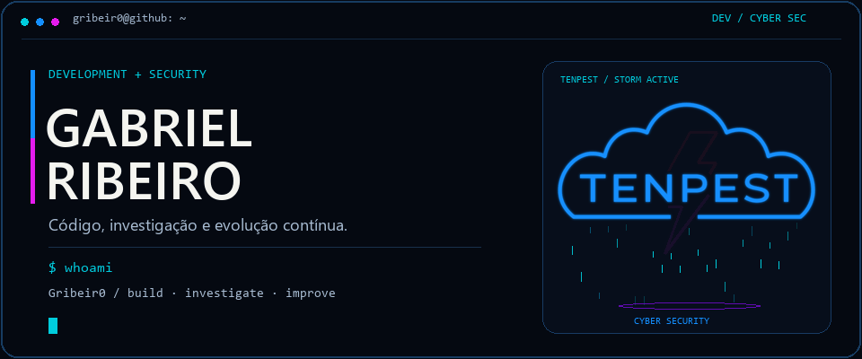

  <picture>
    <source media="(prefers-reduced-motion: reduce)" srcset="./assets/console.png" />
    
  </picture>

  <strong>Construir com curiosidade. Investigar com método. Evoluir com prática.</strong>

  <a href="https://github.com/Gribeir0?tab=repositories">Projetos</a> &nbsp; / &nbsp;
  <a href="https://www.linkedin.com/in/gabriel-sribeiro-/">LinkedIn</a> &nbsp; / &nbsp;
  <a href="mailto:gribeiro237@gmail.com">Contato</a>

## Olá, sou Gabriel Ribeiro

Meu foco está na interseção entre **desenvolvimento de software e cibersegurança**: entender como sistemas funcionam, construir soluções úteis e investigar como torná-las mais seguras.

Gosto de desafios que exigem código, análise e aprendizado contínuo. Fora do terminal: games, esportes e café.

### No meu radar

| Desenvolvimento | Cibersegurança |
| :--- | :--- |
| Aplicações web e experiência de uso | Segurança de aplicações e da web |
| Scripts e automação de tarefas | Investigação de vulnerabilidades |
| Código legível e soluções práticas | Conscientização e prevenção de phishing |

### Projeto em destaque

**[SafePhish](https://github.com/Gribeir0/SafePhish)**  
Manual web do SafePhish — um ponto de encontro entre conteúdo de segurança e desenvolvimento de interfaces.

[`Explorar código`](https://github.com/Gribeir0/SafePhish) · [`Ver outros repositórios`](https://github.com/Gribeir0?tab=repositories)

### Cada contribuição alimenta a próxima fase

  

---

  <code>build · investigate · improve · repeat</code> 
  Tem um projeto ou desafio de segurança em mente? <a href="mailto:gribeiro237@gmail.com">Vamos conversar.</a>

Identidade visual TENPEST · <a href="./assets/tenpest-animated.svg">Logo vetorial animada</a>

